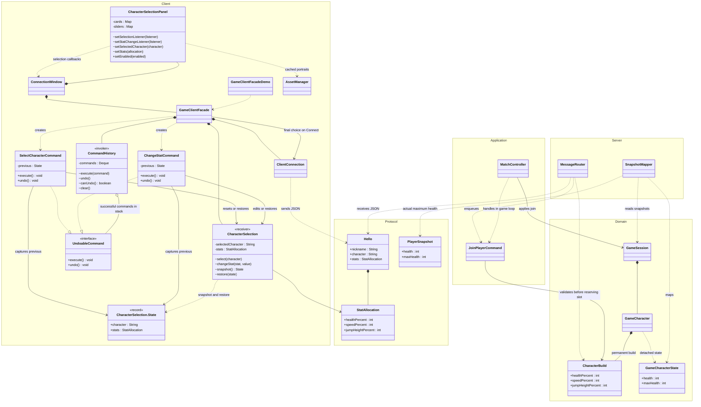

# Character selection and stat builds

The Command pattern belongs to the client. `CharacterSelectionPanel` displays portrait cards and sliders and
reports user requests to `ConnectionWindow`, which delegates to `GameClientFacade`. The facade creates commands
and invokes `CommandHistory`. The panel never calls history directly. Local undo finishes before joining; the
server receives only the final build. `GameClientFacadeDemo` is the second facade client, with its own selection,
history and connection; see the [runnable demonstration](../README.md#facade-demonstration-without-a-game-window).

## Undo and lifecycle

- A stat drag previews values, then creates one `ChangeStatCommand` on release. Keyboard changes also create
  commands. Unchanged values and repeated clicks on the selected character create none.
- Both commands capture the complete immutable state when executed. A character switch resets allocations to
  100/100/100; undo restores the previous character together with its customized values.
- History undoes commands in reverse order. Empty undo does nothing; clearing history leaves selection intact.
  Programmatic card and slider synchronization emits no callbacks.
- Connecting disables editing. Failures and cancellations retain history. `WELCOME` clears it, retaining the
  selected build as the new baseline before notifying clients on the EDT. Each facade owns its history until
  closed; queued events from cancelled/older sessions are discarded.

## Budget and server boundary

Each stat is 50–150% in steps of 5; their total cannot exceed 300. Lower a stat to free points for another;
unused points are permitted. The panel clamps increases and shows the remaining points.

`HELLO.stats` contains `healthPercent`, `speedPercent`, and `jumpHeightPercent`; omission means 100/100/100.
The protocol checks the complete integer shape, while the domain owns budget and range validation. The server
rejects invalid builds with `INVALID_STATS` before reserving a slot or queueing a join. The client cannot supply
absolute health, velocity, or positions.

The game loop applies the validated build. Maximum health and speed scale directly; jump velocity scales by
the square root of the jump-height percentage. Temporary decorators multiply these permanent settings.
Respawn retains the build, restores its full health, and clears temporary effects. All characters currently share
the same three base defaults; their attack loadouts remain separate.
