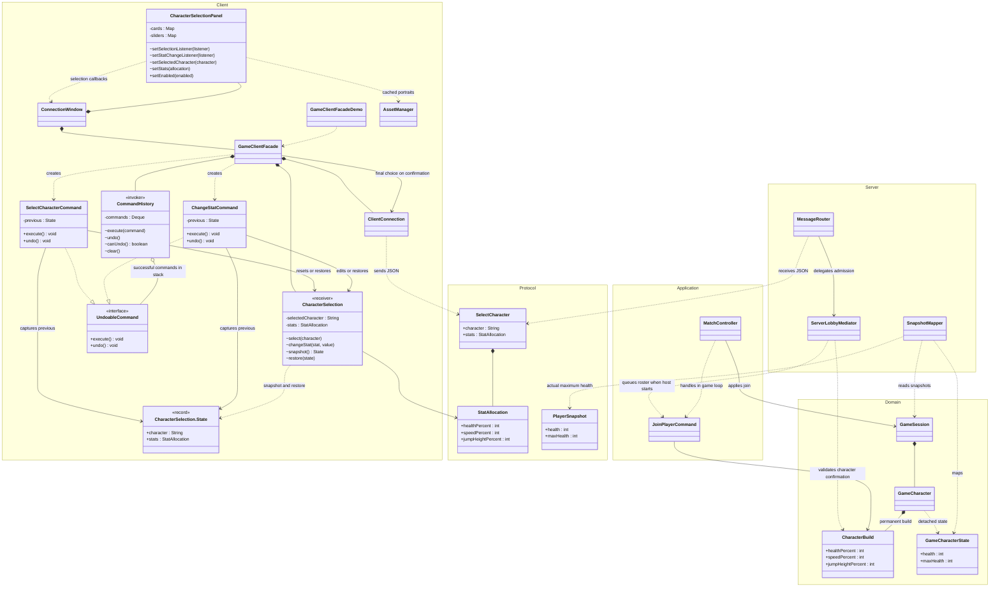

# Character selection and stat builds

The Command pattern belongs to the client. `CharacterSelectionPanel` displays portrait cards and sliders and
reports user requests to `ConnectionWindow`, which delegates to `GameClientFacade`. The facade creates commands
and invokes `CommandHistory`. The panel never calls history directly. Local undo is available in the room’s picker. The server receives the build on confirmation. `GameClientFacadeDemo` is the second facade client, with its own selection,
history and connection; see the [runnable demonstration](../README.md#facade-demonstration-without-a-game-window).

## Undo and lifecycle

- A stat drag previews values, then creates one `ChangeStatCommand` on release. Keyboard changes also create
  commands. Unchanged values and repeated clicks on the selected character create none.
- Both commands capture the complete immutable state when executed. A character switch resets allocations to
  100/100/100; undo restores the previous character together with its customized values.
- History undoes commands in reverse order. Empty undo does nothing; clearing history leaves selection intact.
  Programmatic card and slider synchronization emits no callbacks.
- After admission, players can edit until they confirm their build. Server acceptance clears undo history
  and keeps the build as the new baseline. Failure or cancellation preserves edits and undo history.
- Leaving or host departure returns to the browser. The host can start when everyone has confirmed.
  See [Mediator and lobbies](mediator-lobbies.md).

## Budget and server boundary

Each stat is 50–150% in steps of 5; their total cannot exceed 300. Lower a stat to free points for another;
unused points are permitted. The panel clamps increases and shows the remaining points.

`SELECT_CHARACTER.stats` requires `healthPercent`, `speedPercent`, and `jumpHeightPercent`.
The protocol checks the complete integer shape, while the domain owns budget and range validation. The server
rejects invalid builds with `INVALID_STATS` and lets the player retry in their reserved slot. The client cannot supply
absolute health, velocity, or positions.

The game loop applies the validated build. Maximum health and speed scale directly; jump velocity scales by
the square root of the jump-height percentage. Temporary decorators multiply these permanent settings.
Respawn retains the build, restores its full health, and clears temporary effects. All characters currently share
the same three base defaults; their attack loadouts remain separate.
