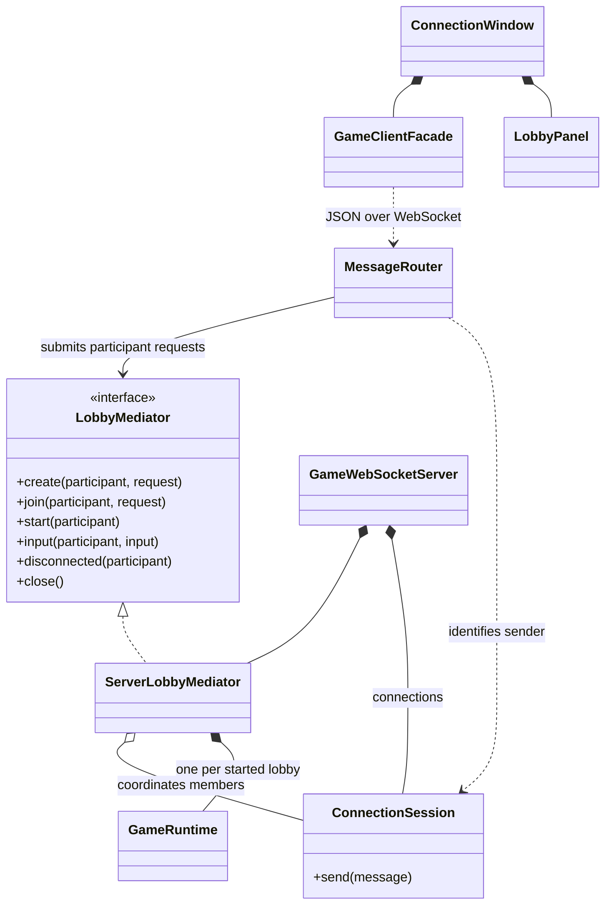

# Mediator and multiplayer lobbies

Character selection comes first. A player creates a lobby and shares its six-character code; others join by
code. Nicknames are display labels, not accounts. Each lobby holds one host and up to three guests. The host
can start with one to four players. The waiting room displays four player cards with character portraits,
nicknames underneath, Host/You indicators, and placeholders for empty slots. There is no ready-up, lobby browser, chat, persistence, or arena switching.

## Pattern participants

| Role | Implementation | Responsibility |
| --- | --- | --- |
| Mediator | `LobbyMediator` | Create, join, start, input, departure and shutdown contract |
| Concrete mediator | `ServerLobbyMediator` | Registry, membership, host permissions, admission state and scoped delivery |
| Colleague | `ConnectionSession` | One participant's transport identity and outbound message sink; no peer references |
| Transport adapter | `MessageRouter` | Converts decoded requests into mediator operations for the sending participant |
| Game owner | `GameRuntime` | Per-lobby bounded command queue, single-owner world and snapshot cadence |

Participants never call other participants. For example, a guest's join is decoded by `MessageRouter` and
submitted to the mediator. The mediator validates membership, reserves a lobby slot, sends `WELCOME` to the
new colleague, and distributes `LOBBY_STATE` to that lobby's colleagues. Host start and departure use the same
coordination point. This server mediator complements the existing client Facade and event Observer patterns.

## Lifecycle and wire flow

1. `CREATE_LOBBY {nickname, character, stats}` creates a waiting room. `JOIN_LOBBY` carries the same fields plus
   `code`. Codes are unique among live lobbies, uppercase letters/digits; pasted codes are trimmed and uppercased.
2. `WELCOME` assigns connection/player IDs and a slot. `LOBBY_STATE {code, hostId, phase, members}` follows,
   with member player IDs, slots, nicknames, and characters. `phase` is `WAITING` or `RUNNING`.
3. The client completes its eight-second admission timeout on `WELCOME`, clears selection undo history, and
   waits without a lobby timeout. Selection is locked; input is suppressed. Only the host has an enabled Start button.
4. `START_GAME {}` derives identity from its connection. The mediator validates the host, closes admission,
   queues the roster, publishes `RUNNING`, then starts the owner loop. No world runs in a waiting room.
5. Gameplay uses the existing `INPUT`, `WORLD_SNAPSHOT`, and `GAME_EVENT` messages, delivered only within that
   lobby. Every lobby uses the server's startup-selected arena recipe, with its own cloned moving platforms,
   NPCs, items, observers, input, and players.
6. A guest disconnect updates the waiting roster or queues a gameplay removal. Only waiting slots may be reused.
   Starting permanently closes admission and reconnects for that lobby.
7. Host disconnect removes the lobby immediately, sends `LOBBY_CLOSED {reason}` to guests, and schedules runtime
   cleanup. Clients disconnect, show the reason, and return to selection with the last accepted build preserved.

A shared mediator monitor orders admission, start, departure, and broadcast decisions. No world entity is mutated
in WebSocket callbacks. Game initialization also occurs on the runtime's owner thread. Cleanup runs on a separate
worker outside the mediator monitor, avoiding joins against a loop that may be publishing. Server shutdown closes
all lobbies and waits for cleanup completion. Each runtime retains the existing bounded 512-command queue,
128-command tick budget, 60 Hz simulation, and 20 Hz snapshots.

Admission errors include `LOBBY_NOT_FOUND`, `LOBBY_FULL`, `LOBBY_STARTED`, `ALREADY_CONNECTED`, and `INVALID_STATS`.
Unauthorized start returns `HOST_REQUIRED`; early input returns `GAME_NOT_STARTED`. Post-admission request errors
are shown without disconnecting a valid member. The former `HELLO` entry is unsupported; deploy updated clients
and server together. No authentication or automatic rejoin is implied by a nickname or lobby code.

## Verification

Run `./mvnw -B -ntp clean verify` (Windows: `.\mvnw.cmd -B -ntp clean verify`) on standalone Java 25.
Tests cover concurrent admission and start/join races, capacity and waiting-slot reuse, malformed DTOs, host-only
start, pre-start input, host departure in both phases, independent worlds/events, client EDT delivery and waiting
states, and worker shutdown. Existing movement/combat/build tests enter through explicit lobbies.

For a desktop check, launch the server and two clients. Select different characters, create a lobby in one client,
join its code in the other, and verify the roster and host-only Start button. Start, move both players, and leave
as host. Both clients should return to selection; the guest should see the closure reason. Repeat with a second
independent lobby and confirm it keeps running when the first closes. The windowless facade demo also creates
and starts a solo lobby before receiving a world snapshot.
