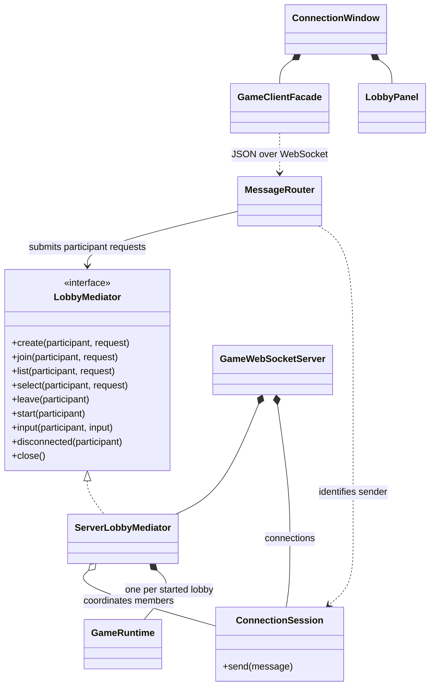

# Mediator and multiplayer lobbies

Players connect to browse waiting rooms with space, create a room, or join by code. Each room holds one host
and up to three guests. Players choose their builds after admission. The host can copy the room code during
selection or while waiting, and can start once every member has confirmed. The waiting room shows portraits,
nicknames, Host/You indicators, and which members are still choosing.

## Pattern participants

| Role | Implementation | Responsibility |
| --- | --- | --- |
| Mediator | `LobbyMediator` | Create, join, start, input, departure and shutdown contract |
| Concrete mediator | `ServerLobbyMediator` | Registry, membership, host permissions, admission state and scoped delivery |
| Colleague | `ConnectionSession` | One participant's transport identity and outbound message sink; no peer references |
| Transport adapter | `MessageRouter` | Converts decoded requests into mediator operations for the sending participant |
| Game owner | `GameRuntime` | Per-lobby bounded command queue, single-owner world and snapshot cadence |

Participants never call other participants. For example, a guest's join is decoded by `MessageRouter` and
submitted to the mediator. The mediator validates membership, reserves a lobby slot, sends `WELCOME` to the
new colleague, and distributes `LOBBY_STATE` to that lobby's colleagues. Host start and departure use the same
coordination point. This server mediator complements the existing client Facade and event Observer patterns.

## Lifecycle and wire flow

1. `LIST_LOBBIES {afterCode}` returns a bounded page of waiting rooms with space. A null cursor starts at
   the first page. The last code on a page is the exclusive cursor for the next page.
2. `CREATE_LOBBY {nickname}` and `JOIN_LOBBY {code, nickname}` reserve a slot. The server sends `WELCOME`
   followed by `LOBBY_STATE`. The member's character is null until confirmed.
3. `SELECT_CHARACTER {character, stats}` validates and records the build. The next `LOBBY_STATE` with the
   member's character acknowledges confirmation and clears the client's undo history.
4. `START_GAME` checks host identity and confirmation for every current member. The mediator locks admission,
   queues the joins, publishes `RUNNING`, and starts the room's game loop.
5. Gameplay commands, snapshots, and events stay within the room's runtime. Each runtime uses its own world,
   built from the arena selected when the server started.
6. `LEAVE_LOBBY` frees a guest slot and acknowledges departure with `LOBBY_CLOSED`. The host leaving
   or disconnecting closes the room for all. Connected clients return to the browser on the same socket.

A shared mediator monitor orders admission, start, departure, and broadcast decisions. No world entity is mutated
in WebSocket callbacks. Game initialization also occurs on the runtime's owner thread. Cleanup runs on a separate
worker outside the mediator monitor, avoiding joins against a loop that may be publishing. Server shutdown closes
all lobbies and waits for cleanup completion. Each runtime retains the existing bounded 512-command queue,
128-command tick budget, 60 Hz simulation, and 20 Hz snapshots.

Admission errors include `LOBBY_NOT_FOUND`, `LOBBY_FULL`, `LOBBY_STARTED`, and `ALREADY_CONNECTED`.
Unauthorized start returns `HOST_REQUIRED`, and an unfinished roster returns `CHARACTERS_PENDING`.
Invalid builds return `INVALID_STATS`. Early input returns `GAME_NOT_STARTED`. Players stay connected
when the server rejects a room request. Deploy the updated client and server together because the room
protocol changed. Nicknames and lobby codes are display and routing identifiers.

## Verification

Run `./mvnw -B -ntp clean verify` (Windows: `.\mvnw.cmd -B -ntp clean verify`) on standalone Java 25.
Tests cover concurrent admission and start/join races, capacity and waiting-slot reuse, malformed DTOs, host-only
start, pre-start input, host departure in both phases, independent worlds/events, client EDT delivery and waiting
states, and worker shutdown. Existing movement/combat/build tests enter through explicit lobbies.

For a desktop check, connect two clients to one server. Create a room as the host, copy its code, and
join from the guest's room list. Confirm the host first and verify that Start stays disabled until the
guest confirms. Start the game, then leave as the host and verify both clients return to the browser.
